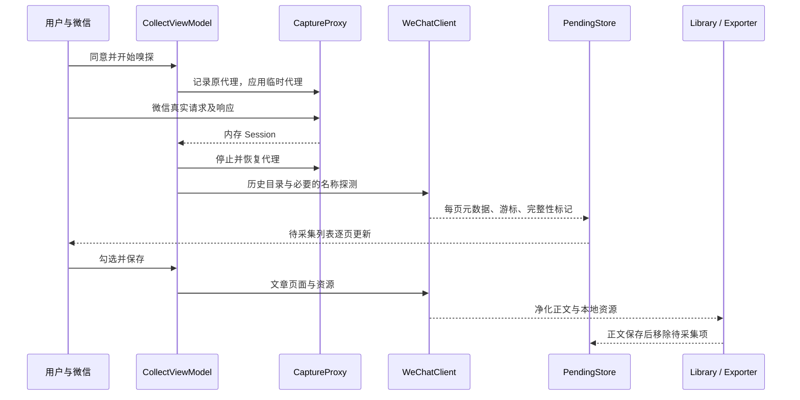

# 文存开发指南

本文描述 WenCun.slnx 对应的当前实现。旧 WeChatExport.* 目录与历史文档不作为当前能力依据。

## 模块与依赖

| 模块 | 职责 | 主要依赖 |
| --- | --- | --- |
| Core/Domain | 文章、会话、待采集、进度与错误类型 | 标准库 |
| Core/Net | HTTP、限速、重定向、历史列表解析 | HttpClient |
| Core/Content | URL 身份、文章解析、HTML 净化 | AngleSharp |
| Core/Collect | 目录发现、正文保存与资源下载编排 | Core 内部模块 |
| Core/Pending | 公众号 JSON 清单与游标 | System.Text.Json |
| Core/Storage | SQLite、复制、文件边界 | Microsoft.Data.Sqlite |
| Core/Export | HTML/MD/TXT/DOCX、PDF 编排 | DocumentFormat.OpenXml |
| Capture | 本地代理、WinINET、证书、恢复日志 | Titanium.Web.Proxy |
| Desktop | WPF 视图、ViewModel、设置、阅读器、PDF | WebView2 |
| Tests | 单元、回归、实际 WPF 窗口 smoke | xUnit / Test SDK |

Core 面向 net10.0，其他项目面向 net10.0-windows。Desktop 引用 Core 与 Capture，Capture 只引用 Core。PDF 通过 Core 的 IPdfRenderer 接口注入 Desktop 实现。

准确依赖版本以 csproj 为准。Directory.Build.props 统一可空引用、C# 14、警告视为错误和产品版本；global.json 固定 SDK。版本源、验证门禁和发版步骤见 [发布规约](RELEASE.md)，scripts/verify.ps1 会校验 README/CHANGELOG 与版本源一致。主项目当前没有 CI 工作流和依赖锁文件，不能用“CI 已保证”代替实际验证。

## 两段采集流程



### 捕获生命周期

CollectViewModel.StartAsync 最多等待请求三分钟。CaptureProxy 监听 loopback 随机端口，仅解密标准 HTTPS 的微信文章域名。

会话由请求 URL、Cookie 和响应 Set-Cookie 合并生成。带 uin/key 的候选优先；否则等三秒收集窗口，使用首个可用候选。目标 Biz 可锁定，避免打开另一个公众号时串号。

证书本地自签名，名称限定 mp.weixin.qq.com，保存于当前用户 My 存储，使用时加入当前用户 Root 信任存储；BasicConstraints 不声明 CA。界面中的“根证书”指其信任位置，不是可任意签发的通用 CA。私钥由 Windows CNG 管理，证书不随每次采集退出删除。

CaptureJournal 先完整写盘再无覆盖发布，避免新捕获覆盖未恢复记录。StopAsync 幂等，重复调用返回同一清理结果；仅恢复仍属于本次捕获的代理字段，保留用户后来改动。Desktop 在成功、取消、超时、异常路径显式读取停止警告。

### 目录与公众号名称

Collector.DiscoverAsync 调用 /mp/profile_ext?action=getmsg，每页数量 10。接口页是消息页，一条消息可能包含多篇文章；主文与 multi_app_msg_item_list 都保留索引。

can_msg_continue 决定是否继续，next_offset 必须前进，不能用“本页正好 10 条”覆盖终止标记。无效 JSON、接口错误和跨公众号文章拒绝更新该页进度。

名称优先使用调用者、pending、当前文库的已有真实名称，再尝试示例文章；若捕获目录请求，则从目录首篇文章补名。ArticleParser.ReadAccountName 不要求页面有可归档正文，使用 #js_name、.profile_nickname、.rich_media_meta_nickname、.account_nickname_inner。找不到就留空，显示层可回退 Biz，不能把 Biz 当作已解析名称。

PendingStore.Merge 去重并同步文章名称，重复发现不自动清除失败原因。每页成功才写游标；当前库已有正文的文章不重新入队。

未完成目录从原游标续跑；完成目录从零开始，遇到非空且没有新增项的页后停止。这是增量策略，不是对历史消息编辑、删除、重排的完全校验。清空清单不重置历史游标，Complete 也不代表已保存所有正文。

### 正文、资源与导出

SaveSelectedAsync 顺序处理所选文章。FetchBodyAsync 获取页面，ArticleParser 识别正文并对 canonical、og:url 和脚本身份进行检查；跨公众号或文章标识不一致不入库。

净化移除脚本、表单、iframe、视频等主动内容，对元素、样式与资源域名使用白名单。资源仅允许微信相关域，重定向逐跳验证。目录 JSON、HTML、资源上限分别为 4 MiB、12 MiB、20 MiB，读取过程中检查大小。

请求串行发送：目录请求间隔两秒，其余 600 毫秒；连接和请求设超时。响应体读取沿用调用方取消令牌，仍需注意持续慢速响应的整体时限。

资源准备后先写 NotFetched 元数据，再由 SaveContent 事务提交正文与 Ready/Partial 状态。新正文落盘后才删除旧身份记录。资源失败记录 Error，继续保存正文；取消向上传播，不能留下“已保存但无正文”。

正文成功与导出成功独立。导出失败不退回 pending。重新导出读取数据库最新元数据。输出目录带 ID 摘要；先写临时文件，再发布替换。PDF 返回实际非空文件才算成功。

## 数据契约

| 实体 / 存储 | 标识与状态 | 规则 |
| --- | --- | --- |
| Article / articles | Id；NotFetched / Ready / Partial / Failed | Id 是 biz、mid、idx 的 SHA-256，忽略 sn；短链暂用路径身份 |
| ArticleContent / contents | ArticleId | 正文、时间、资源、警告；外键关联文章 |
| Asset | Source / LocalPath / Error | LocalPath 相对文库；失败不冒充本地资源 |
| PendingAccount / JSON | Biz、Offset、Complete | 名称、发现时间和文章列表；不含会话 |
| PendingArticle | Id + Biz | 标题、署名作者、链接、日期、失败原因；不含正文 |
| Account / accounts | Biz | 文库统计；界面合并 pending 的进度和未保存公众号 |
| Session | Biz + 内存凭据 | 不序列化落盘，不跨公众号保存 |
| ExportState | None / Succeeded / Failed | 独立于正文状态，失败信息用于重导出 |

SQLite 使用 WAL，每次连接启用外键。迁移仅补缺失字段，没有完整版本迁移框架，不能假定旧 WeChatExport 数据库可以直接打开。CopyTo 使用 SQLite Backup API 与 staging 目录，避免遗漏 WAL 数据；要求业务停止写入，数据库和资源不是共同事务快照。

pending JSON 为 PascalCase；SQLite 内部资源 JSON 由 Storage.Json 使用 camelCase。读列表跳过损坏文件；指定公众号读取失败抛 Storage 错误，写入不得覆盖原文件。

Library.Query 的 State 精确匹配：Ready 不包含 Partial，NotFetched 只查询数据库旧记录；Accounts.Saved 合计 Ready 和 Partial。页码最小 1，PageSize 为 1～200；默认日期倒序、空日期最后、同日期按 ID 排序；搜索标题、公众号、作者。

GetCheckpoint 读取 accounts 表，不存在返回 (0,false)。SaveCheckpoint 可回退游标并更新时间；EnsureAccount 只创建/更新名称。当前嗅探真正使用的是 pending 游标，不要把两者混为一个状态源。

## 桌面端与修改入口

MainViewModel 持有 Library、三个页面与保存/导出信号量。嗅探也检查工作状态；切库、删除、新任务不能与当前任务交叉。客户端按任务释放。

首次启动且没有文库或待保存数据时进入“采集”；已有数据时进入“资料库”。目录获取、保存和导出的界面动作统一使用“获取目录”“保存”“导出”，不将会话、捕获等内部实现术语暴露给普通用户。保存所选逐篇显示进度，成功后自动进入资料库；PendingViewModel.Load 保留已选项，新文章默认不勾选，保存按钮显示当前勾选数量。AccountsViewModel 合并 SQLite 和 pending。LibraryViewModel 的“待保存”分支同样读取 pending。

配置持久化、ReaderWindow 预览目录和 WebView2 用户数据目录都使用构造函数传入的 appRoot。测试必须使用临时目录，不能用静态 App.AppRoot 覆盖调用者隔离。

| 修改行为 | 入口 | 同步检查 |
| --- | --- | --- |
| 名称、标题、正文 | ArticleParser | Collector 补名、三处列表、Parser/Collection/NativeUi 测试 |
| 翻页 | WeChatClient.ParsePage | 多图文、空页、频控、终止标志、跨公众号 |
| Cookie/签名 | CaptureProxy | 响应生命周期、空值回退、禁止落盘、代理恢复 |
| 清单 | PendingStore | 损坏数据、原子写、名称、选择、切库 |
| 导出资源与路径 | ExportPaths/Exporter/FileBoundary | 同名冲突、旧文件保护、删除归属、ReaderWindow |
| 新格式 | Models/Exporter/AppConfig/CollectViewModel/XAML | 枚举值、选项、失败状态、README |
| 数据库 | Library.Schema/Migrate | 旧库复制、默认值、查找统计、用户备份 |
| 主题、控件、图标、字体 | Themes/Light.xaml、Dark.xaml、Controls.xaml、Assets/wencun-icon.svg、Assets/wencun.ico、Assets/wencun-mark.xaml、Assets/Fonts | 三页浅/深色、1000 宽窗口、焦点与选中态、32px 图标、字体许可 |
| 阅读页与导出样式 | MarkupWriter.Css/Html | HTML 导出、ReaderWindow、打印与窄屏 |

图标母版和多尺寸 ICO 是正式源码资产。`scripts/render-icon.py` 读取 `Assets/wencun-icon.svg`，更新 `Assets/wencun-icon.png` 与 `Assets/wencun.ico`，并在 `.tools/logo/soft-3d/` 输出仅供人工检查的图片。脚本依赖 Python、Pillow、Playwright 和本机 Microsoft Edge，不参与正常构建或测试；`.tools` 中的日志、检查图和 binlog 都是可删除的中间产物，不能作为修改入口或提交内容。

## 验证与发布

```powershell
powershell -NoProfile -ExecutionPolicy Bypass -File scripts\verify.ps1
powershell -NoProfile -ExecutionPolicy Bypass -File scripts\publish.ps1 -Output publish\review
```

`verify.ps1` 依次校验版本镜像、构建和全部测试；`-SkipNativeUi` 只用于没有桌面会话的自动化环境。发布版本、标签和远程步骤按 [发布规约](RELEASE.md) 执行，不在这里另写一套顺序。

NativeUiTests 需要 Windows 桌面，会短暂创建真实 MainWindow 并输出截图路径；使用普通 Application 测试宿主加载生产主题，不执行 App.OnStartup。它验证实际绑定与可见文字，不等于微信或 PDF 现场验收。

原生 smoke 同时覆盖 1000 宽窗口下失败与已保存文章同屏：状态标签与表头在固定列内居中，失败行的“阅读”“重试”“文件夹”完整显示且互不重叠。截图与临时文库位于 `%TEMP%\WenCunUiTests`，复核后可删除；验证结束后清理当日测试临时目录，不删除其他日期的验收资料。

既有 CaptureTests 创建并清理独立 CNG 密钥，不加入信任存储；新增 Capture 回归使用假代理和临时数据。真实系统代理、证书安装应单独验收。

人工验收：首次公众号名称、未保存统计、分页刷新后的勾选、取消/重新捕获、同名导出、复制文库、任务中切库、失败重导出；真实网络再补缓存页、频控、会话失效、企业代理、异常退出、图片与 PDF。

## 已知边界

- 无评论/合集/视频批采、日期范围筛选、MHTML、CSV、MCP、定时任务；旧版材料不能作为当前能力证明。
- 静态 HTML 不能保证还原客户端动态内容；不可放宽选择器把缺失正文判为成功。
- Word 合并单元格、嵌套列表、WebP 及复杂 Markdown 转义仍需专项格式夹具。
- Partial 计入账号已保存统计，但“已保存”筛选只显示 Ready，Partial 需从“全部”查看。
- 失败批量重试默认最多 500 条，无持久任务队列，重启需重新捕获会话。
- 单实例保护、采集崩溃的即时代理恢复尚未实现；不要同时启动多个实例采集。
- 阅读器临时目录在窗口关闭后尽力清理，文件仍被 WebView2 占用时可能保留。
- 资源完整性汇总、PDF 图片与字体等待和真实渲染验收仍待补齐。
- 文件清理为尽力执行；共享旧目录、改名前目录、锁定文件可能保留，数据库和文件系统不在一个事务。
