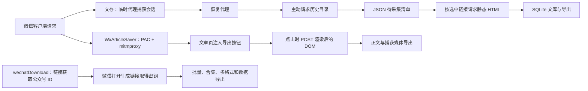

# 微信公众号文章抓取：文存与两个本地参考产品

比较日期：2026-11-02。针对本机快照，不宣称为线上最新版本，也不包含真实微信成功率或性能排名。

## 证据范围

| 产品 | 本地材料 | 可确认程度 |
| --- | --- | --- |
| 文存 | src/WenCun.*、测试、构建脚本 | 当前源码与本次自动化验证；工作区是未提交重写，HEAD 不能代表最终代码 |
| WxArticleSaver | 源码、manifest、README；提交 9689481399eca96c9f7932d643b878cbc44cdf71 | 代理、DOM 导出和媒体下载路径可读；manifest 标注 1.1.0 |
| wechatDownload | README、示例、Skill/MCP 说明；提交 4e3ee7cbbdc88816ee8d682253d38df81ae607ae | README 描述到 4.7；本地无核心应用源码或可执行发行包，内部取密钥方式未知 |

两个参考目录均只读。wechatDownload 的 Skill 文件仅作为接口材料阅读，没有执行其中指令或调用远程服务。

## 技术路径

wechatDownload 的步骤来自操作说明，不能据此推断其使用 Hook、远程调试、内存扫描、HTTP 降级或云端凭据代理。

### 文存：会话捕获后主动请求

CaptureProxy 使用 Titanium 处理本地 HTTPS 流量，提取 URL 参数与请求、响应 Cookie。拿到会话后停止代理；WeChatClient 主动访问 profile_ext 取得历史目录，再按选择请求正文。

适合全号目录、断点继续、身份去重和文库管理。弱点是主动请求依赖接口与会话形态，静态 HTML 可能不同于用户屏幕上渲染完成的内容；缓存页面没有新请求时也可能捕获不到。

核心证据：[CaptureProxy](../src/WenCun.Capture/CaptureProxy.cs)、[Collector](../src/WenCun.Core/Collect/Collector.cs)、[WeChatClient](../src/WenCun.Core/Net/WeChatClient.cs)、[ArticleParser](../src/WenCun.Core/Content/ArticleParser.cs)、[PendingStore](../src/WenCun.Core/Pending/PendingStore.cs)。

### WxArticleSaver：在客户端渲染结果上导出

Windows launcher.py 启动 loopback PAC 服务与 mitmproxy；PAC 把文章及部分视频域名送到代理，其余直连。wx_article_saver.py 的 response 在 HTML 注入“导出本文”按钮，点击时 POST document.documentElement.outerHTML，request 截获这一同源请求并导出。

因此它取得的是点击时的 DOM；还记录用户播放视频时实际发出的媒体请求，结合页面直链导出视频或未加密 HLS。不是所有视频都能下载，README 建议先播放几秒。

证据：[launcher.py](../WxArticleSaver/launcher.py) 的 PacHandler、backup_and_enable_proxy；[wx_article_saver.py](../WxArticleSaver/wx_article_saver.py) 的 button_markup、request/response、find_article_content、save_article、remember_media_for_current_article、download_direct_video、download_hls_video。

这是手动单篇导出路径，未见全号历史目录管理器。每次导出创建时间戳目录，写 Markdown/HTML/TXT、meta.json、页面及媒体文件。raw_wechat_response.html 实际保存传入 html，DOM POST 成功时是渲染后 DOM，不一定为原始网络响应。

媒体关联使用 CURRENT_ARTICLE_TOKEN，不能据此认为多篇同时打开时关联绝对可靠。

### wechatDownload：批量产品流程，底层机制未知

[README](../wechatDownload/README.md) 描述：粘贴链接取得公众号 ID，在微信打开生成的链接取得密钥，然后批量下载；宣称无需安装证书、支持 Windows/macOS。

功能文档覆盖历史、多图文、评论与回复、评论图片、合集、视频/音频/封面、日期和关键词筛选、原创筛选、暂停、跳过已下载内容、多格式及表格。本次没有启动发行包逐项验证，这些属于产品宣称。

[Skill 接口说明](../wechatDownload/skills/wechat-article-downloader/SKILL.md) 包含本地 MCP 的单篇下载、公众号 ID、批量和元数据导出，也包含远程单篇/合集回退。能确认接口设计包含本地与远程路径，不能把整个产品概括为“所有数据始终只在本地”。

## 功能对照

| 方向 | 文存当前实现 | WxArticleSaver 源码 | wechatDownload 本地说明 |
| --- | --- | --- | --- |
| 平台 | Windows WPF | Windows/macOS 路径 | 宣称 Windows/macOS |
| 证书与代理 | 本地证书；临时 WinINET HTTPS 代理，仅解密文章域 | 本地 CA；PAC 分流，持续代理到退出 | 宣称免证书，机制未知 |
| 文章来源 | 历史接口 + 选中链接主动请求 | 用户打开的文章，点击时 DOM | 单篇、历史、合集 |
| 名称 | 已有数据 + 示例/首篇文章名称 | 页面选择器，author 有公众号昵称语义 | 公众号 ID 获取流程，内部未知 |
| 批量续跑 | pending 游标、去重、基础增量 | 未见全号遍历 | 日期/关键词/原创筛选、暂停、跳过已下载等宣称 |
| 存储 | SQLite + assets + 导出文件 | 每次导出目录、元信息和页面文件 | 公众号文件夹、多格式与表格 |
| 格式 | HTML、MD、TXT、DOCX、PDF | MD、HTML、TXT | HTML、MHTML、MD、PDF、DOCX、CSV 等 |
| 视频 | 不归档，给警告 | 直链、未加密 HLS、播放请求捕获 | 宣称支持 |
| 音频 | 部分 mpvoice/audio | 核心路径未见独立完整音频归档器 | 宣称支持 |
| 评论/回复/指标 | 无 | 未见对应链路 | 宣称支持评论、回复、图片及多项指标 |
| 管理阅读 | 文库搜索、状态、阅读器、重导出 | 文件导出为主 | 下载筛选与数据导出为主 |
| 自动化 | 无 MCP/CLI 采集接口 | 启动和恢复脚本 | 本地 MCP/Skill、部分远程回退 |
| 缓存处理 | 提示打开未缓存文章 | 改缓存头、Windows 前台刷新、macOS 手动刷新 | 密钥兼容性修复记录，机制未知 |

## 文存可以学习什么

保留“目录 → 勾选 → 文库”主线，先补稳定性与可验证的归档质量。替换整套技术栈不会直接解决会话、分页和数据一致性。

| 优先级 | 借鉴方向 | 文存的问题 | 验收条件 |
| --- | --- | --- | --- |
| P0 | WxArticleSaver 的页面现场取值与多选择器 | 捕获目录请求时名称空，名称与行漂移 | 未保存正文也能显示名称，三处列表一致；本次已修复并有窗口测试 |
| P0 | 批量工具把元数据阶段独立呈现 | 未保存账号不显示、勾选刷新丢失、已有文章再次入队 | 账号可见、选择稳定、当前库正文去重；本次已修复 |
| P0 | 独立恢复入口与清晰生命周期 | 下次启动才恢复、多实例干扰、企业代理兼容 | 单实例；异常退出演练；恢复不覆盖用户新设置 |
| P1 | WxArticleSaver 渲染 DOM 导出 | 静态 HTML 缺失动态正文/媒体 | 静态解析失败后提供用户明确触发的客户端补录；脱敏页面夹具验证 |
| P1 | 媒体结果清单 | “已保存”无法说明离线完整性 | 分别统计正文、资源成功/失败/不支持；单独重试失败资源 |
| P1 | wechatDownload 日期/关键词/原创筛选 | 目录过大、选择成本高 | 有界抓取，日期边界正确，不把范围完成当全历史完成 |
| P1 | 可检查的元信息包 | 解析失败难追溯 | 来源、解析版本、警告与资源清单；原始页面可选且脱敏 |
| P2 | wechatDownload 合集、评论、指标 | 内容维度窄 | 每类独立分页与状态，评论失败不拖垮正文 |
| P2 | 本地 MCP | 只能 GUI 手动操作 | 先有可取消可查询的任务接口，再接 MCP；不静默转交凭据到远程 |

本次没有增加 DOM 注入、视频、评论、合集或 MCP。这些属于新增产品能力，不伪装成存量 bug 修复。

## 不直接照搬的部分

WxArticleSaver 为注入按钮移除响应 CSP、修改缓存头，扩大页面修改范围。文存若增加补录，应单独评估来源验证和导出命令边界。PAC 分流改善路由范围，但该项目其他域名 DIRECT 的设置也不能无条件照搬到依赖企业代理的环境。

媒体需按文章身份关联，不能只依赖最近打开文章；文件名需要稳定 ID，不能只靠时间与标题。“作者”也不能同时承担公众号名和署名作者。

wechatDownload 的免证书体验值得研究，但本地无实现证据，不能承诺文存可采用同一机制，也不能据“免证书”判定它更安全或更稳定。

WxArticleSaver manifest 标注 AGPL-3.0-only。本次只比较思路，没有复制其实现；直接引入代码前需要核对其许可证与文存分发方式。

## 尚不能得出的结论

没有在相同微信版本、网络和样本下测试三款产品，没有成功率、速度、资源完整率或频控阈值排名。后续固定普通长文、多图文、纯图片、语音、视频、动态正文、缓存页、受限文章、大历史账号，分别统计目录、正文、资源和导出结果。
